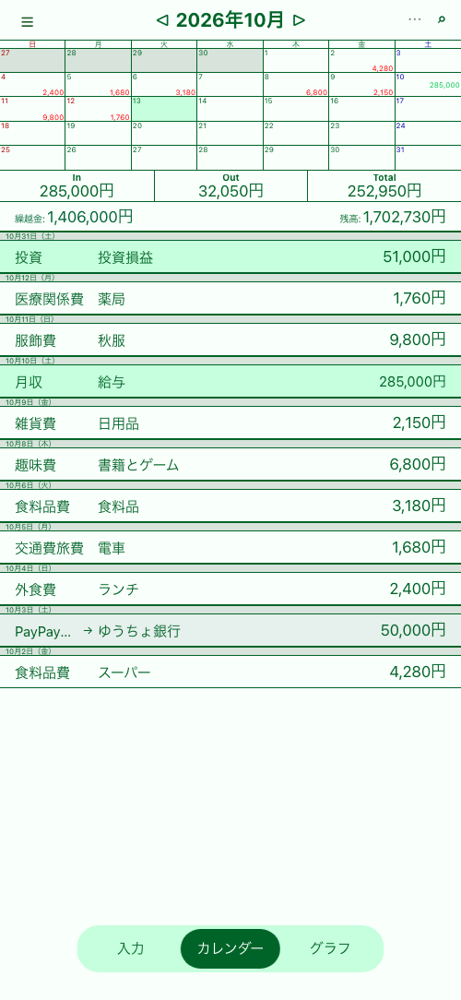
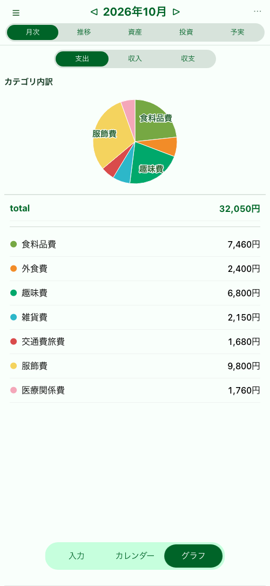

# Household（家計簿）

（このREADMEは大部分がCodexにより作成されています．）

React + TypeScript + Vite で作成している個人向けの家計・資産管理アプリです．日々の支出・収入・資金移動から，口座残高，クレジットカード，投資，予算までを一つのPWAで管理します．

- 本番: https://household.ozw1504.workers.dev
- ステージング: https://household-staging.ozw1504.workers.dev

## スクリーンショット

掲載画像には，README表示用に作成した架空のサンプルデータを使用しています．

<p align="center">
  
  
  
</p>

## 主な機能

### 入力・カレンダー・履歴

- 支出・収入・資金移動（Move）の登録と編集
- レシート明細の仮登録と一括登録
- 内税・外税と税率（0 / 8 / 10%）への対応
- 四則演算対応の金額入力テンキー
- 直前に使用したカテゴリ・拠出元などの入力状態を保持
- 月次カレンダー，月次収支，総資産の表示
- 日付ごとの明細表示とクレジットカード引落明細の内訳表示
- 条件を指定した履歴検索
- 取引やレシート単位の削除と取消
- 未来の記録，通算・特別区分の表示切替

### 口座・カテゴリ・自動記録

- 現金，銀行，電子マネー，投資，クレジットカード口座の管理
- 口座の開始残高・開始日・有効状態・入力候補順の設定
- クレジットカードの限度額，締め日，引落日，引落元の設定
- カード利用額から引落記録を自動生成
- 支出・収入カテゴリの追加，名称変更，無効化，統合
- 日次・週次・月次の定期Moveを自動生成
- 月末時点の口座残高・カード利用可能額・投資評価額の確認と差額調整

### グラフ・分析

- 月次のカテゴリ別収支と明細
- 年間推移とカテゴリごとの月推移
- 口座別の資産構成・残高推移
- 投資口座別の評価額，損益額・損益率，構成比
- カテゴリ別・総額の予算設定と予実管理
- 「我慢」「衝動買い」を記録する損得カウンター
- 口座・カテゴリ名に対応する固定配色
- 明細を残したまま集計金額・割合を隠す金額マスク

### データ・認証・通知

- Google OAuthによる許可ユーザー限定ログイン
- ローカル保存を利用したオフライン動作
- Cloudflare D1を介した端末間同期
- JSONバックアップのエクスポートと，マージ／置換による復元
- 既存家計簿CSVの検証付きインポート
- 月末更新の未完了通知とWeb Push通知
- PWAインストールとService Workerの自動更新

## 画面構成

- `入力`: 支出・収入・Moveの登録
- `カレンダー`: 月次カレンダー，収支・資産サマリー，取引履歴
- `グラフ`: 月次，推移，資産，投資，予実／損得
- `設定`: 口座，カテゴリ，定期Move，通知，表示，CSV取込，JSONバックアップ，ログアウト

デスクトップでは入力とカレンダーを同じダッシュボード上に表示し，モバイルでは下部ナビゲーションと入力シートを使用します．

## データモデル

取引の中心となる型は `src/types/Transaction.ts` の `Transaction` です．

- `type`: `expense` | `income` | `move`
- `amount`: 金額
- `date`: 記録日（`YYYY-MM-DD`）
- `destinationDate`: Moveの移動先反映日
- `name`: 摘要
- `category`: 支出・収入カテゴリ
- `source`: 拠出元または移動元
- `destination`: 移動先
- `memo`: メモ
- `classification`: `normal` | `settled` | `special`
- `groupId`: レシート明細のグループID
- `taxMode` / `taxRate` / `taxBaseAmount`: 税設定
- `system`: カード引落，月末調整，定期Move，投資損益などの自動記録情報

口座，カテゴリ，予算，投資評価額，月末実残高，定期Move，損得カウンターなどはそれぞれ独立したストアで管理します．ブラウザでは `localStorage` を同期的な読み書きに使用し，IndexedDBにもオフライン用の複製を保持します．ログイン中は変更をCloudflare D1と同期します．

## 開発

```bash
npm install
npm run dev
```

開発環境で `VITE_GOOGLE_CLIENT_ID` を設定していない場合は，Googleログインとリモート同期を無効化してローカル動作します．

### 検証コマンド

```bash
npm test
npm run lint
npm run build
npm run validate
```

`npm run validate` はテスト，lint，本番ビルドを順に実行します．

## デプロイ運用

通常はステージングで動作確認してから本番へ反映します．

```bash
# 検証、ステージングDBマイグレーション、ステージングデプロイ
npm run deploy:staging

# deploy:staging の短縮形
npm run deploy

# 検証、本番DBマイグレーション、本番デプロイ
npm run deploy:prod
```

- ステージングは専用D1 `household-staging` を使用し，本番D1へ接続しません．
- ステージングではcronを設定せず，VAPID秘密情報も通常は登録しないためPush通知を送信しません．
- Workerには環境ごとに `GOOGLE_CLIENT_ID`，`ALLOWED_EMAILS`，`SESSION_SECRET` を設定します．
- Push通知を使用する本番環境では `VAPID_PUBLIC_KEY`，`VAPID_PRIVATE_KEY`，`VAPID_SUBJECT` も設定します．
- フロントエンドには対応する `VITE_GOOGLE_CLIENT_ID` をビルド時に設定します．

ステージングD1を固定の架空データへ戻す場合は，ステージングへ一度ログインして同期利用者を作成した後，次を実行します．

```bash
npm run db:seed:staging
```

投入元は `fixtures/staging-seed.json` です．スクリプトは対象環境をステージングに固定し，同期利用者が1名であることと，全口座名が `STG` で始まることを確認してから既存データを置換します．本番D1は操作しません．

## 技術スタック

- React 19
- TypeScript
- Vite
- React Router
- Recharts
- vite-plugin-pwa / Workbox
- Cloudflare Workers / D1
- Google Identity Services
- Web Push
- Vitest / Testing Library

## ディレクトリ構成

- `src/App.tsx`: ルーティング，アプリ状態，設定画面
- `src/components/`: 入力，カレンダー，履歴，グラフ，各種設定UI
- `src/data/`: ローカル永続化とデータストア
- `src/types/`: 取引，口座，カテゴリなどの型定義
- `src/utils/`: 集計，自動記録，バックアップ，CSV取込などのロジック
- `worker/index.ts`: 認証，同期，Push通知のWorker API
- `migrations/`: D1マイグレーション
- `tests/`: 単体・コンポーネントテスト
- `fixtures/`: ステージング用固定データ
- `public/`: PWAアイコンとService Worker補助ファイル
